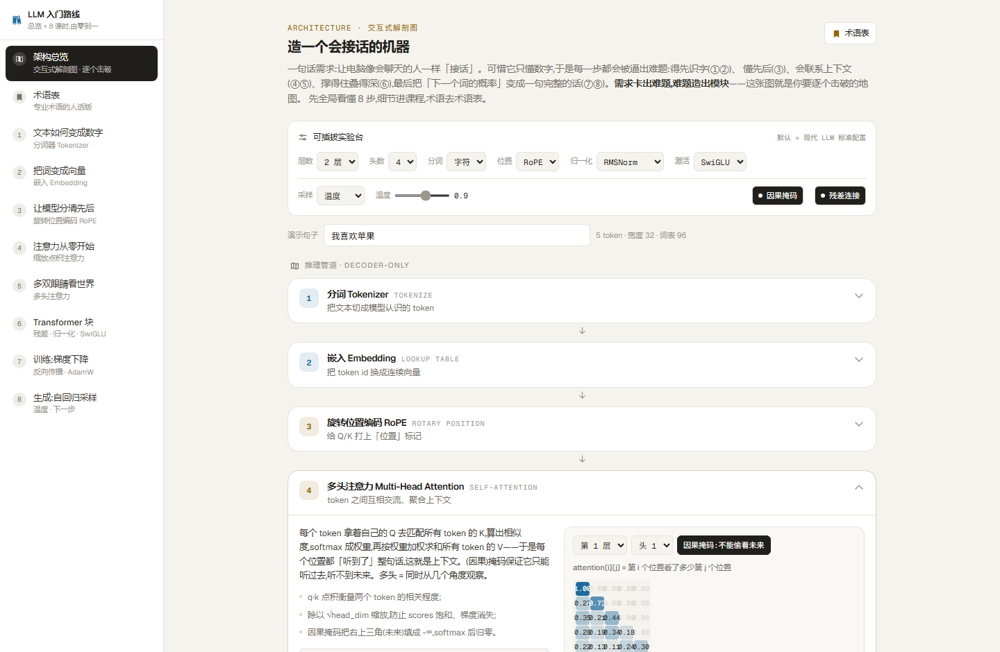
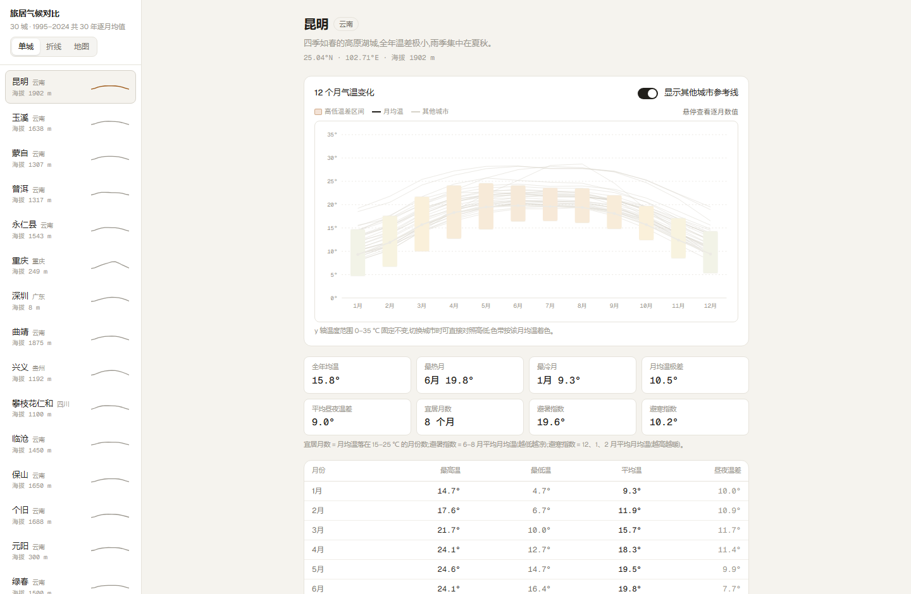
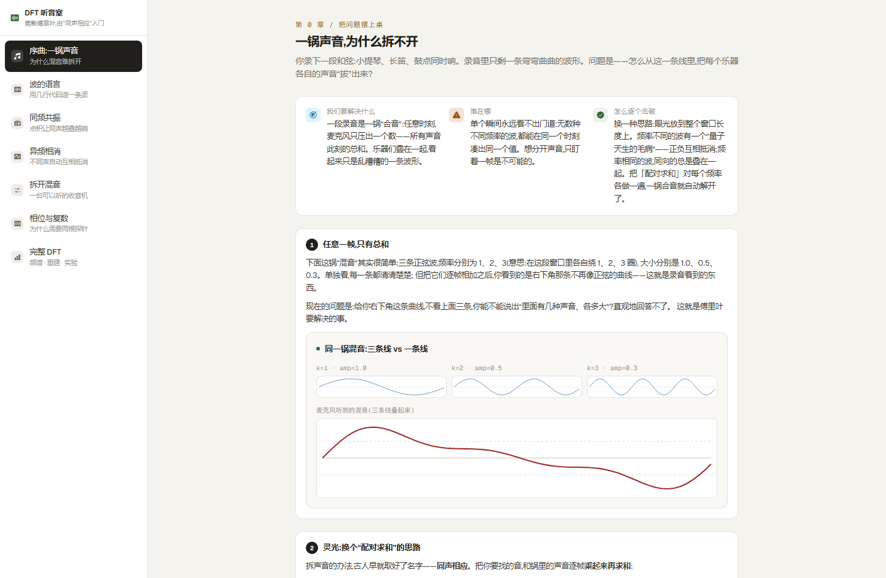

# 工具箱 (toolkit)

手写的交互式小工具合集——不堆功能,每个工具都围绕一个原理或一个问题,打开浏览器就能玩。

▶ **[在线体验](https://toolkit-flax.vercel.app)** ｜ [设计取舍](DESIGN.md)

[](https://github.com/wy2010344/toolkit/actions/workflows/ci.yml)
[](LICENSE)



## 工具一览

| 工具 | 做什么 | 技术看点 | 在线可玩 |
| --- | --- | --- | --- |
| [LLM 实验室](https://toolkit-flax.vercel.app/tools/llm-lab) | 8 节课从零手写一个微型 LLM,走完分词 → 注意力 → 训练 → 生成的完整原理 | 纯 TypeScript 真·梯度下降(loss 真实下降),注意力热力图、可插拔架构模块、术语表 | ✅ |
| [DFT 听音室](https://toolkit-flax.vercel.app/tools/dft-lab) | 不背公式,用可跑的例程和声音理解离散傅里叶变换 | "探针点积"实现、波形 / 乘积柱 / 频谱联动 SVG、Web Audio 可听化 | ✅ |
| [旅居气候对比](https://toolkit-flax.vercel.app/tools/climate) | 把云南的宜居度画成连续等值面,鼠标任意位置可读数;31 座候选城市的单城温度带、多城折线与偏好排行 | 浏览器端栅格插值 + marching squares、二值探针栅格逐点读数、免 key 在线底图叠加等高线 | ✅ |
| [Loop Engineering 流程图](https://toolkit-flax.vercel.app/tools/loop-engineering) | 人机闭环工程模型的流程图 | 源码即图,改 Mermaid 文本即时重绘 | ✅ |
| [目录对比同步](https://toolkit-flax.vercel.app/tools/dir-diff) | 逐文件哈希对比两个目录,diff 查看,按方向同步 | NDJSON 流式进度、size 短路 + 流式 SHA-1、dry-run 同步计划、git 分支切换 | ⚠️ 仅本地 |





## 本地运行

```bash
pnpm install
pnpm dev
```

打开 http://localhost:3000。

- 除「目录对比同步」外,所有工具都是纯浏览器端实现,无需任何后端;
- 「目录对比同步」需要访问本机文件系统与 git,在线部署时界面会明确提示,请本地使用。

## 技术栈

Next.js 16 (App Router) · React 19 · TypeScript · Tailwind CSS 4 · cmdk · mermaid · leaflet · highlight.js

## 结构速览

```
app/
  page.tsx                 工具入口
  tools/<name>/page.tsx    各工具页
  api/dirdiff/*            目录对比的本机文件 API(NDJSON 流式)
components/
  lesson/                  课程式教学壳(LessonLayout: Shell / Step / Formula / Question)
  llm/ dft/ climate/ loop/ dirdiff/   各工具的客户端实现
lib/
  llm/ dft/ climate/       纯算法,与 UI 解耦,可独立通读
  dirdiff/                 目录对比的共享类型与服务端实现(walk / hash / sync)
DESIGN.md                  每个工具的关键设计取舍
```

## License

[MIT](LICENSE)
